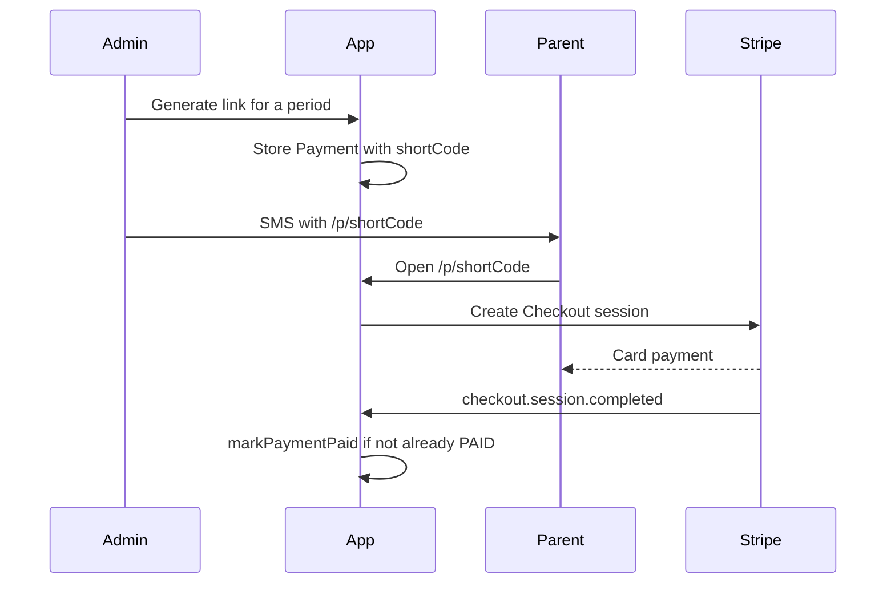

# Architecture

The public site collects a lead. The admin panel turns that lead into a student with a monthly bill. Payments go out as links the studio sends itself. Stripe is an implementation detail behind those links.

## Lead lifecycle

| Status            | Meaning                                    |
| ----------------- | ------------------------------------------ |
| `PENDING_DEPOSIT` | Form submitted, deposit not paid           |
| `PAID_DEPOSIT`    | Deposit paid, place is held                |
| `ACTIVE`          | Attending                                  |
| `CANCELLED`       | Deposit never arrived, or the link expired |
| `RESIGNED`        | Left during the year                       |
| `REFUNDED`        | Deposit returned                           |

A level has a capacity pool. `PENDING_DEPOSIT`, `PAID_DEPOSIT` and `ACTIVE` occupy a seat. The other three do not. A single group also has its own seat limit (default 8). The pool and the group limit are different numbers: the pool is "how many students at this level", the group limit is "how many fit in this time slot".

## Billing

Amounts are integers in grosze. `computeAmountDue` is `max(0, base - discount)`. A negative discount is a surcharge.

For a normal month the suggestion is the price-list amount minus the student's standing discount. In the first billable month the suggestion also subtracts a paid deposit and any referral bonus. Individual lessons have no monthly price; the suggestion reuses the previous month's base amount.

The panel's default month is the current one through the 20th, and the next month from the 21st, so links go out before the month starts.

`TuitionPeriod` is unique on `(leadId, periodMonth)`. `Payment` is unique on `(leadId, billingPeriod, type)`. Creating the same bill twice hits the database, not a check that can be forgotten.

## Payment links

The SMS contains our URL. The Stripe session exists only after the click, and it can expire without making the SMS useless: opening the link again creates a new session for the same payment row.

`getCheckoutProvider()` returns the Stripe implementation. A second provider implements the same `CheckoutProvider` type. Already-sent links keep working because they never stored a Stripe URL.

The webhook checks `Stripe-Signature` against `STRIPE_WEBHOOK_SECRET` and ignores any other event. `markPaymentPaid` returns early when the payment is already `PAID`, and it still retries the referral reward so a crash after the payment commit does not lose the discount.

## Admin access

`/admin` renders a login form. A correct `ADMIN_SECRET` sets an HMAC-signed, httpOnly cookie (`matma_admin_session`, 14 days). Server Actions call `assertAdminSession()` and read that cookie.

`/api/cron/*` expects `Authorization: Bearer <CRON_SECRET>`. That is the header Vercel Cron sends when `CRON_SECRET` is set. The admin password is not accepted there.

## Data

PostgreSQL, schema `matma`. Prisma models: `Lead`, `Group`, `Teacher`, `Payment`, `TuitionPeriod`, `MessageTemplate`, `User`. Migrations live in `prisma/migrations` and are applied with `npm run db:deploy` (`migrate deploy`).

## Analytics

The cookie banner gates GA4, Meta Pixel, Clarity and the Conversions API. Server events are sent only when the consent cookie is `granted`. The browser pixel and the server event share an `event_id` (the payment token for a purchase), which is how Meta deduplicates them.
